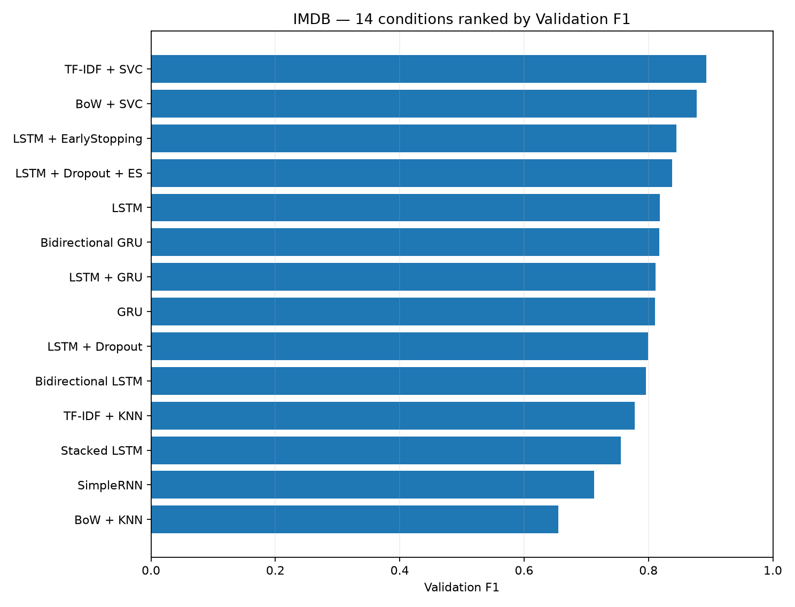
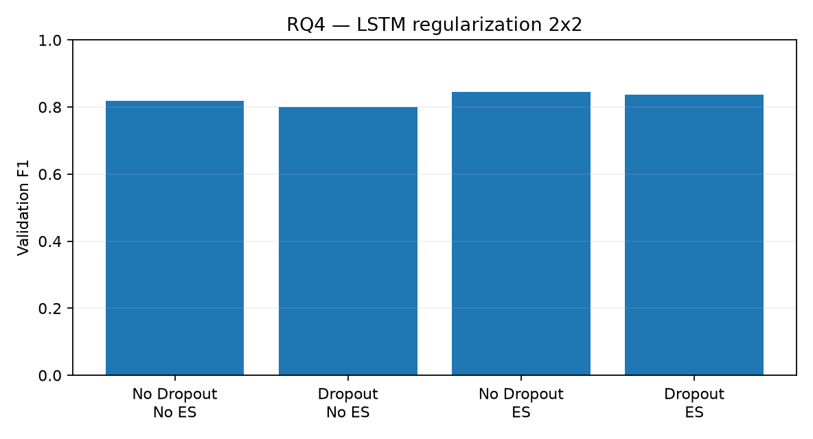
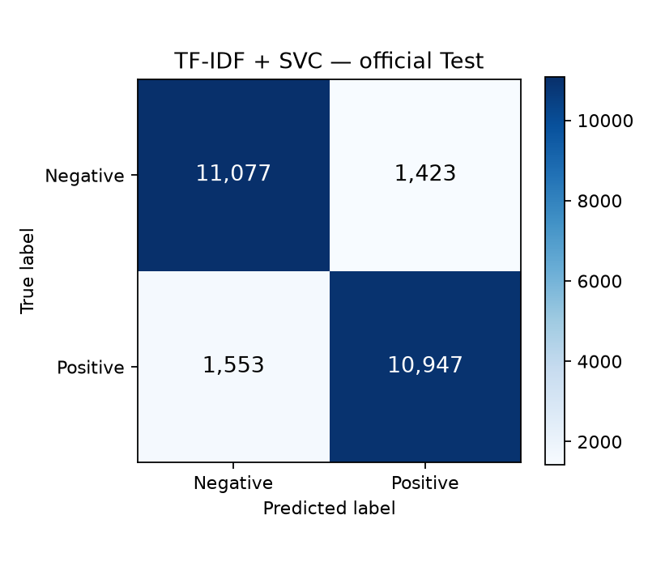
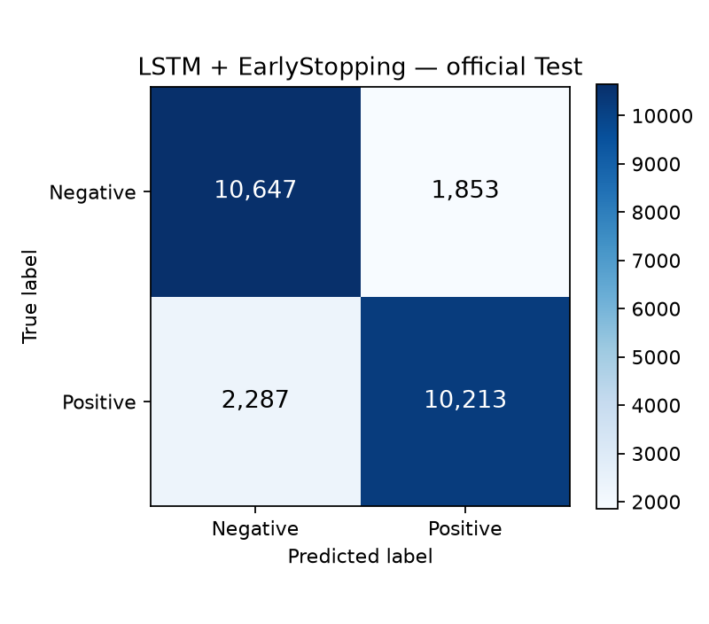

# IMDB NLP / RNN — 16 組矩陣比較實驗

以 IMDB 電影評論情緒分類為研究主題，比較傳統機器學習、RNN 家族與 GloVe 預訓練詞向量的實測表現。專案採用 **dedup_v1.1 實驗資料版本**，提供原始碼、Jupyter Notebook、訓練紀錄、評估結果與視覺化圖表。

**English:** Reproducible research archive of 16 IMDB binary sentiment classification conditions (4 traditional ML, 10 recurrent deep learning, 2 post-test exploratory GloVe models). The original images and saved evaluation outputs are included; full serialized model and feature artifacts are available in a GitHub Release. Third-party IMDb review text is not redistributed.

## 實驗流程

Clean raw text → BoW / TF-IDF → KNN / SVC，或 Clean text → TextVectorization (160 tokens) → Embedding (100d) → SimpleRNN / LSTM / GRU → sigmoid。

- Train 19,823、Validation 4,956、Official Test 25,000。
- 原始訓練來源 25,000 筆，先排除 123 筆跨 Test 完全文字重複，再排除 98 筆 Train 內重複。正式 Test 仍維持原始 25,000 筆。
- Train-only 向量詞彙建置，固定 Seed 42。
- 只有 14 組原始比較模型參與 Test 前的選模；GloVe 兩組是在正式 Test 後才新增，**只報 Validation**。

## 16 組 Validation F1

| Run | 模型 | F1 |
|---|---|---:|
| ML-01 | BoW + KNN (cosine) | 65.54% |
| ML-02 | BoW + SVC (linear) | 87.73% |
| ML-03 | TF-IDF + KNN (cosine) | 77.78% |
| ML-04 | TF-IDF + SVC (linear) | **89.32%** |
| DL-01 | SimpleRNN | 71.25% |
| DL-02 | LSTM | 81.85% |
| DL-03 | GRU | 81.02% |
| DL-04 | LSTM + Dropout | 79.93% |
| DL-05 | LSTM + EarlyStopping | **84.52%** |
| DL-06 | LSTM + Dropout + EarlyStopping | 83.79% |
| DL-07 | Stacked LSTM | 75.56% |
| DL-08 | LSTM + GRU | 81.17% |
| DL-09 | Bidirectional LSTM | 79.58% |
| DL-10 | Bidirectional GRU | 81.77% |
| TL-01 | GloVe Frozen + GRU | 79.99% |
| TL-02 | GloVe Fine-tuning + GRU | 80.34% |

注意：這 16 組不屬於完全交叉的因子設計；在不同子矩陣中重複引用原有的 LSTM、GRU 基準模型，沒有重複計算。

## 正式 Test：兩個預先鎖定模型

| 模型 | Test Accuracy | Test Precision | Test Recall | Test F1 |
|---|---:|---:|---:|---:|
| ML-04 TF-IDF + SVC | 88.10% | 88.50% | 87.58% | **88.03%** |
| DL-05 LSTM + EarlyStopping | 83.44% | 84.64% | 81.70% | 83.15% |

混淆矩陣（列為實際 Negative/Positive，欄為預測 Negative/Positive）：
- ML-04：[[11077, 1423], [1553, 10947]]
- DL-05：[[10647, 1853], [2287, 10213]]

ML-04 在這次官方測試中少了 1,164 筆誤判。這只能描述本次固定資料與模型條件；單一 Seed 無法代表所有情況。

## 原始結果圖（不是依 CSV 後製的替代圖）

| TF-IDF + SVC Test CM | LSTM + ES Test CM |
|---|---|
|  |  |

其他原始 Learning Curves、Validation Confusion Matrices、GloVe 圖表請見 `results/figures/`、`results/final_test/`、`optional_glove/results/`。

## 檔案說明

- `notebooks/`：00–07 的 Jupyter Notebook，包括已執行輸出與 Test 前 07 備份。
- `src/`：資料去重、特徵向量、模型建構、訓練與評估程式。
- `config/`：各實驗條件及鎖定參數。
- `results/`：驗證及測試的 CSV/JSON、原始圖表和 Gate A/B/C/E 報告。
- `optional_glove/`：事後探索性 Gate D 的設定、程式與結果。
- `tests/`、`tools/`：自動測試及實驗工具。
- `data/processed/`：切分清單、SHA-256 與去重摘要（不含評論全文）。
- `docs/EXPERIMENT_MILESTONES.md`：實驗階段、模型選擇與評估流程。

### 如何取得完整實驗產物？

從 **[Releases](../../releases)** 下載完整研究附件，內含訓練權重（Keras/Joblib）、特徵矩陣、Notebook、Learning Curves、Confusion Matrices、GloVe 詞向量及實驗報告。影評全文資料請依照 [資料來源與使用說明](DATA_AND_LICENSE.md) 取得。

重現步驟與原始環境說明：[REPRODUCIBILITY.md](REPRODUCIBILITY.md)。

## Sources & attribution

- [Stanford Large Movie Review Dataset — Maas et al., ACL 2011](https://ai.stanford.edu/~amaas/data/sentiment/)
- [Stanford GloVe — Pennington et al., EMNLP 2014](https://nlp.stanford.edu/projects/glove/)
- [Keras](https://keras.io/)、[scikit-learn](https://scikit-learn.org/)

第三方的原始 IMDB 影評不在 Git Repo 或 Release 內；GloVe 公開詞向量使用 [PDDL 1.0](https://opendatacommons.org/licenses/pddl/1.0/) 授權。**此公開 Repository 尚未替原創程式碼指定開源授權**。詳見 [DATA_AND_LICENSE.md](DATA_AND_LICENSE.md)。
